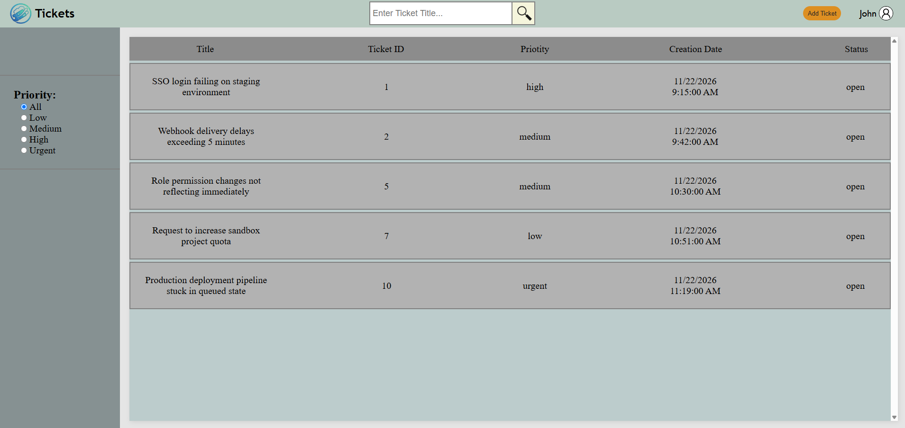
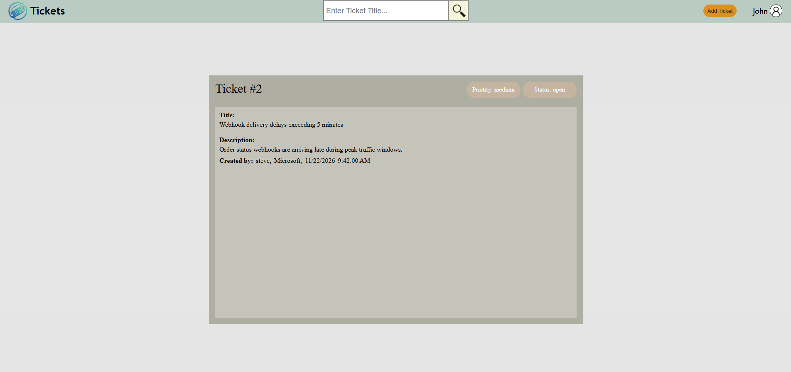
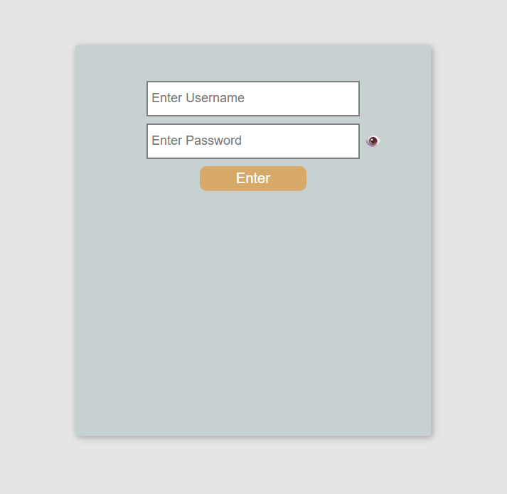

<div align="center">

# Ticket Submit project featuring a React frontend and an Express backend

</div>

## Things to know

If you log in as an agent, you will see all the tickets, but if you login as a normal user you will only be able to see the tickets of yout own company. 
You will find the login credentials in backend/src/data/mockUsers.mjs

## 🛠️ How to Setup and Run

To run this application locally, you need to open **two separate terminals**.

### 1. Start the Back-End Server
In your first terminal, navigate to the `back-end` folder and start the server:

```bash
cd back-end
npm install
npm start
```
The server will run on http://localhost:3000.

### 2. Start the React App
In your second terminal, navigate to the `front-end` folder and start the development server:

```bash
cd front-end
npm install
npm start
```
The React app will open in your browser (usually at http://localhost:3001 or http://localhost:5173).

### ⚠️ Requirements
Make sure both terminals remain open while using the app.
Ensure CORS is enabled in your Express server to allow the React app to fetch data.





